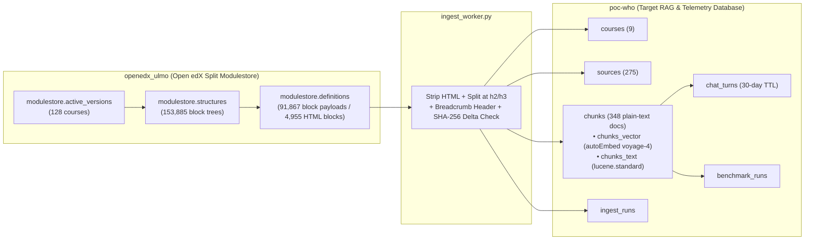

# WHO Academy — AI Course Assistant (`voyage-4` + `rerank-3` + MongoDB Atlas)

A grounded AI Course Assistant for **WHO Academy (Open edX)** powered by:
- **MongoDB Atlas Automated Embedding (`autoEmbed`)** with **Voyage AI `voyage-4`** (`$0.06 / 1M tokens`)
- **MongoDB Atlas Hybrid Search (`$rankFusion`)** combining Vector Search (`$vectorSearch`) and Full-Text Search (`$search` with `lucene.standard`)
- **Voyage AI Reranking (`rerank-3` / `rerank-3-lite`)** at `https://ai.mongodb.com/v1/rerank` with a strict **`≥ 0.50` relevance cutoff**
- **Single-LLM-Call Grounded Answer Streaming (`SSE`)** via Azure AI Foundry / OpenAI (`gpt-4o-mini` / `gpt-4o`) with clickable `[S1]`, `[S2]` Open edX unit citations (and **`0 LLM calls / $0.00`** when blocked by the `< 0.50` cutoff)

---

## 1. Quick Start (3 Steps)

### Step 1 — Configure `.env`
```bash
cp .env.example .env
```
Fill in your credentials in `.env`:
- `MONGODB_URI` — MongoDB Atlas connection string
- `MONGODB_DB_NAME` — Target RAG database (e.g. `poc-who`)
- `OPENEDX_MODULESTORE_DB_NAME` — Open edX Split Modulestore database (`openedx_ulmo`)
- `VOYAGE_API_KEY` — MongoDB Atlas Model API key (`https://ai.mongodb.com/v1`)
- `AZURE_OPENAI_API_KEY` / `OPENAI_API_KEY` — Azure AI Foundry or OpenAI API key for Step B6 grounded answer generation

### Step 2 — Sync WHO Courses (HTML + GridFS PDFs) from Open edX Modulestore into RAG Chunks
```bash
.venv/bin/python ingest_worker.py
```
*Reads published WHO courses from `openedx_ulmo` (`modulestore.definitions` HTML blocks + `fs.files`/`fs.chunks` GridFS PDFs), strips HTML tags / extracts PDF page text via `pypdf`, prepends course/section/unit breadcrumbs, and writes plain-text chunks to `poc-who.chunks` (`397` chunks total: `348` HTML + `49` PDF chunks, skipping unchanged units via SHA-256).*

### Step 3 — Start the FastAPI Server & Open the Web Studio
```bash
.venv/bin/uvicorn main:app --reload --port 8000
```
Open **[http://127.0.0.1:8000/dashboard](http://127.0.0.1:8000/dashboard)** in your browser.

---

## 2. Project File Structure

```text
.
├── main.py                  # FastAPI server & REST / SSE endpoints
├── db.py                    # MongoDB connection & Atlas Search / Vector Search index setup
├── ingest_worker.py         # Open edX Split Modulestore extractor, HTML cleaner & SHA-256 delta sync
├── rag_service.py           # Query router, Hybrid Search, Voyage AI reranker & SSE answer streamer
├── benchmark_service.py     # Side-by-side Voyage AI model & search mode benchmark engine
├── dashboard_ui.py          # 5-tab interactive Web Studio (/dashboard)
├── requirements.txt         # Python dependencies
├── .env.example             # Environment variable template
└── docs/
    ├── TECHNICAL_ARCHITECTURE_AND_FAQ.md # Architecture deep-dive, UML flow diagrams, DB schema & FAQ
    ├── architecture_specification.md     # Detailed technical specification
    └── benchmark_report.md               # Latest auto-generated Voyage AI model comparison report
```

---

## 3. Interactive 5-Tab Web Studio (`/dashboard`)

Open **[http://127.0.0.1:8000/dashboard](http://127.0.0.1:8000/dashboard)** to explore the 5 interactive tabs:

1. **`1. Course Topics & Sample Questions`:** Plain-English catalog summary of all indexed WHO courses (`H0118EN`, `0006_BEC_EN`, `H0117EN`, `HQ_SPTB_EN`, `H0140EN`, `IHH`, `MAT`, plus the restricted `BIO+2026` security test) with one-click buttons that launch any question in Tab 2.
2. **`2. Live Course Assistant (Q&A Demo)`:** Real-time 3-step pipeline trace (**`1. Learner Course Access Filter`** $\rightarrow$ **`2. MongoDB Atlas Hybrid Search`** $\rightarrow$ **`3. Voyage AI Reranker (>= 0.50) + 1 LLM Call`**), live per-1,000-query cost badges, and a full-width formatted LLM answer hero card with interactive `[S1]` / `[S2]` citations.
3. **`3. Open edX Course Ingestion`:** HTML chunking sandbox and full lecture reader showing how raw Open edX HTML blocks are stripped of tags, prefixed with `Course | Section | Unit` breadcrumbs, and written as plain text to `poc-who.chunks` (where Atlas `autoEmbed` generates `voyage-4` vectors automatically).
4. **`4. Search & Reranker Benchmark`:** Evaluates 5 search & reranker profiles across the **10-Question WHO Golden Benchmark Suite** (`100%` $\rightarrow$ `90%` $\rightarrow$ `80%` $\rightarrow$ `70%` $\rightarrow$ `40%` Top-1 Accuracy staircase) with a transparent 4-stage cost breakdown (`~$0.08 / 1,000 questions` for Search + Rerank).
5. **`5. System Health Check`:** Live pre-demo readiness check pinging MongoDB Atlas (`poc-who` & `openedx_ulmo`), Voyage AI (`ai.mongodb.com/v1/rerank`), and the Step B6 Chat Model Gateway.

---

## 4. MongoDB Database & Collection Architecture

Your MongoDB Atlas cluster hosts two databases that work together:



### A. Source Database: `openedx_ulmo` (Open edX Split Modulestore)

| Collection | Docs | Purpose |
| :--- | :---: | :--- |
| **`modulestore.active_versions`** | **128** | Course catalog entry points (`org` + `course` + `run`, e.g. `course-v1:WHOA+H0118EN+Q1_2025`). Points via `versions.published-branch` (`ObjectId`) to `modulestore.structures`. |
| **`modulestore.structures`** | **153,885** | Course DAG trees (`course` $\rightarrow$ `chapter` $\rightarrow$ `sequential` $\rightarrow$ `vertical` $\rightarrow$ `html` blocks). Each block points via `definition` (`ObjectId`) to `modulestore.definitions`. |
| **`modulestore.definitions`** | **91,867** | Holds the raw block content (`fields.data` contains the raw HTML lecture text for the `4,955` `html` blocks). |

#### Real WHO Courses Extracted from `openedx_ulmo`
| Course ID | Title | HTML Blocks | Chunks in `poc-who` | Key Topics |
| :--- | :--- | :---: | :---: | :--- |
| `course-v1:WHOA+H0118EN+Q1_2025` | *Developing, Translating, and Disseminating Guidance for Clinical Trials* | 83 | 67 | WHA75.8 resolution, randomization, blinding, loss to follow-up bias |
| `course-v1:WHOA+0006_BEC_EN+2026` | *Basic Emergency Care (BEC): Approach to the acutely ill and injured* | 133 | 113 | ABCDE primary survey, SAMPLE history, Shock, Altered Mental Status, Trauma |
| `course-v1:WHOA+H0117EN+2025_Q1` | *Global Scales for Early Development (GSED) Short Form* | 119 | 113 | Child neurodevelopment (0–36 months), ODK (Open Data Kit) tablet app |
| `course-v1:WHOA+HQ_SPTB_EN+2025` | *Social Protection for People Affected by Tuberculosis* | 46 | 24 | End TB Strategy, catastrophic costs, 2023 MAF-TB operational guidance |
| `course-v1:WHOA+H0140EN+2025_Q4` | *Research Ethics Online Training (Part 2)* | 33 | 16 | CIOMS International Ethical Guidelines, ICH E6 (R3) Good Clinical Practice |
| `course-v1:WHOA+bbt+bbt` | *Building Blocks Course Template* | 16 | 9 | WHO Academy course authoring templates |

### B. Target RAG Database: `poc-who` (`MONGODB_DB_NAME`)

| Collection | Docs | Key Fields & Purpose |
| :--- | :---: | :--- |
| **`courses`** | **9** | Course metadata (`_id`, `title`, `org`, `language`, `version`, `updated_at`). |
| **`sources`** | **292** | Tracks each Open edX lecture unit and GridFS PDF (`_id`, `course_id`, `unit_title`, `section`, `url`, `sha256`, `status`) so unchanged units and PDFs are skipped during incremental syncs. |
| **`chunks`** | **397** | **Searchable Knowledge Base (`348` HTML + `49` GridFS PDF chunks).** Stores plain-text chunks (`_id`, `course_id`, `section_title`, `text` with breadcrumb header, `url`, `sha256`, `is_active: true`). Indexed by `chunks_vector` (`autoEmbed` `voyage-4`) and `chunks_text` (`lucene.standard`). |
| **`ingest_runs`** | **21+** | Audit log of each ingestion sync (`sources_seen`, `sources_changed`, `chunks_upserted`, `chunks_deactivated`). |
| **`chat_turns`** | Dynamic | Stores learner Q&A turns (`session_id`, `learner_id`, `question`, `rewritten_query`, `answer`, `citations`, `created_at`). Expires automatically after **30 days** via TTL index `idx_chat_turns_ttl`. |
| **`benchmark_runs`** | Dynamic | Stores model benchmark comparison matrices executed from Tab 3. |
