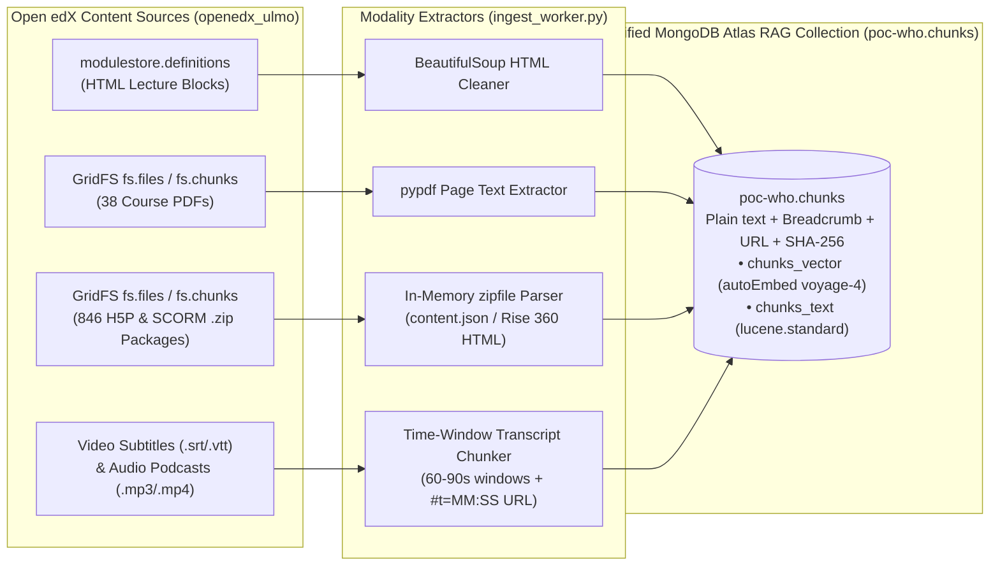

# What's Next: Extending Ingestion to SCORM / H5P Packages, Video & Podcasts, and All 128 Multilingual Courses

This document outlines the production roadmap for expanding the **WHO Academy Open edX Learner Assistant** beyond HTML lecture blocks and GridFS PDFs to cover **interactive SCORM / H5P packages**, **Video & Audio Podcasts**, and **all 128 multilingual courses** in `openedx_ulmo` — **without changing a single line of search, reranking, or LLM code**.

---

## 1. Current vs. Next-Phase Content Inventory in `openedx_ulmo`

An audit of `openedx_ulmo.modulestore.definitions` (`91,867` blocks) and `openedx_ulmo.fs.files` (`1,688` GridFS assets) shows the following distribution of course content:

| Content Type in Open edX (`openedx_ulmo`) | Volume in DB | Status in Current PoC | Next-Phase Action |
| :--- | :---: | :--- | :--- |
| **HTML Lecture Units (`html`, `about`)** | `4,955` blocks | **Indexed** (`348` chunks across 6 courses) | Expand from 6 courses to all `128` courses (`~$0.15` total `voyage-4` embedding cost). |
| **GridFS PDF Handouts (`application/pdf`)** | `38` PDFs | **Indexed** (`49` chunks from `17` PDFs) | Index remaining course PDFs (e.g., `WHOA+ECJTN` Ebola & Marburg IPC modules). |
| **SCORM / Rise 360 / H5P Packages (`application/zip`)** | `846` ZIPs | Skipped (`scorm_v2`, `h5pxblock`, `cmi5`) | Unpack `.zip` in memory from `fs.chunks`, extract instructional text, skip embedded quiz answers. |
| **Videos & Podcasts (`video`, `.srt`, `.mp4`, `.mp3`)** | `45` media files + `video` blocks | Skipped (`video`) | Ingest `.srt`/`.vtt` captions (or one-time STT transcripts) with timestamped deep links (`#t=135s`). |
| **Graded Quizzes & Exams (`problem`, `openassessment`)** | `7,875` blocks | **Permanently Excluded** | **Keep excluded by design** so learners cannot use the AI assistant to cheat on WHO certification assessments. |

---

## 2. Core Architectural Principle: One Unified `chunks` Collection

Because **MongoDB Atlas Automated Embedding (`autoEmbed` with `voyage-4`)** generates embeddings automatically from `chunks.text`, adding SCORM, H5P, Video, or Podcast content requires **zero changes** to:
- The MongoDB Atlas Vector Search index (`chunks_vector`) or Lexical Search index (`chunks_text`)
- The `$rankFusion` Hybrid Search query (`rag_service.py`)
- The Voyage AI `rerank-3` (`>= 0.50` cutoff) stage
- The single-LLM-call SSE answer streamer and `[S1]`/`[S2]` citation badges

Every new modality simply writes plain-text chunks with a modality-aware breadcrumb and URL into `poc-who.chunks`:

---

## 3. Best Practices for Implementing SCORM / Articulate Rise 360 & H5P Ingestion

Out of `1,688` files in `openedx_ulmo.fs.files`, **`846` are `application/zip` archives** powering `h5pxblock`, `scorm_v2`, and `cmi5` interactive units.

### A. How H5P and SCORM Packages Are Stored in Open edX
1. **H5P Archives (`h5pxblock`):**
   * Stored as a `.zip` (or `.h5p`) archive containing `h5p.json` (metadata/title) and `content/content.json` (all slide text, accordions, interactive book chapters, and flashcards).
2. **SCORM / Articulate Rise 360 Archives (`scorm_v2` / `cmi5`):**
   * Stored as a `.zip` archive containing `imsmanifest.xml` (table of contents and launch path) and either `scormcontent/index.html` or a base64/JSON course payload (`und.js` / `course.json`) with lesson titles and body text.

### B. 5 Implementation Best Practices for SCORM & H5P
1. **In-Memory Extraction from GridFS (`io.BytesIO` + `zipfile.ZipFile`):**
   * Never write temporary `.zip` files to disk. Reassemble `fs.chunks` in memory via `io.BytesIO(raw_bytes)` and open directly with Python's built-in `zipfile.ZipFile`.
   * Enforce a **Zip Bomb Guard**: skip any entry whose uncompressed size exceeds `25 MB` or is a binary media asset (`.mp4`, `.png`, `.woff`).
2. **Strict Assessment Filtering Inside H5P / SCORM (Anti-Cheating Rule):**
   * H5P and SCORM packages often mix instructional slides (`H5P.CoursePresentation`, `H5P.Accordion`, `H5P.InteractiveBook`) with embedded quiz questions (`H5P.MultiChoice`, `H5P.TrueFalse`, `H5P.QuestionSet`, `H5P.Blanks`).
   * **Best Practice:** Whitelist instructional H5P library types and **strip `H5P.MultiChoice` / `quiz` nodes** (or strip the `correct` answer flags and feedback strings) before chunking, preserving the same exam-integrity guarantee we enforce on Open edX `problem` blocks.
3. **Preserve Interactive Hierarchy in Breadcrumbs:**
   * Interactive packages contain internal sub-slides or accordion panels. Include the slide or panel title in the chunk breadcrumb:
     `{Course Title} > {Section} > {Unit Title} (Interactive H5P — Slide 4: Clinical Triage)`
4. **Link Citations Back to the Open edX Parent Unit URL:**
   * Unlike standalone PDFs, learners cannot open a raw `.zip` file URL. Link the chunk's `url` to the **Open edX Vertical Unit URL** (`/learning/course/{course_id}/{vertical_block_id}`) that hosts the SCORM/H5P XBlock so clicking `[S1]` opens the interactive module directly inside the LMS.
5. **Use GridFS `md5` / `sha256` Before Unzipping:**
   * Check `fs.files.md5` against `poc-who.sources` **before** fetching `fs.chunks`. If the `.zip` package has not changed since the last sync, skip downloading and unzipping its binary chunks completely (`0` I/O).

---

## 4. Best Practices for Implementing Video & Audio Podcast Ingestion

`openedx_ulmo` contains `video` blocks in `modulestore.definitions` as well as **`31` `audio/mpeg` podcasts and `14` `video/mp4` files** in `fs.files`.

### A. Two-Tier Extraction Strategy
1. **Tier 1 — Existing Captions/Subtitles (`.srt` / `.vtt` / Transcripts) — Cost: `$0.00`:**
   * Always check first if the Open edX `video` block already references a `.srt` or `.vtt` transcript in `fs.files` (or a PDF transcript, like the 12 `Transcription_Module_...pdf` files we already indexed in `H0140EN`).
2. **Tier 2 — Batch Speech-to-Text (Whisper / Cloud STT) Only on Delta Changes:**
   * For `.mp3` podcasts or `.mp4` videos that lack `.srt`/`.vtt` captions, run an asynchronous speech-to-text model (e.g., OpenAI `whisper-1` / Azure Speech) **once at ingestion time** to generate timestamped `.vtt` segments, and cache the resulting transcript hash in `poc-who.sources` so the audio is never transcribed twice.

### B. 5 Implementation Best Practices for Video & Podcasts
1. **Chunk by Time Windows (`60–90 seconds` / `~250–350 words`), Never by Single Subtitle Lines:**
   * Raw `.srt` files split text every `2–4 seconds` (5–10 words per line), which destroys semantic context for vector embeddings.
   * **Best Practice:** Merge consecutive subtitle cues into **60-to-90-second semantic windows** (~250–350 words) with a **15-second overlap** between adjacent chunks, splitting early if the speaker pauses or changes topic.
2. **Include `[MM:SS – MM:SS]` in Both the Breadcrumb and Citation URL:**
   * Format the chunk breadcrumb with the exact time range:
     `{Course Title} > {Section} > Video: {Unit Title} [02:15 - 03:40]`
   * Append the start timestamp in seconds to the chunk's `url`:
     `/learning/course/{course_id}/{vertical_block_id}?t=135`
   * When the learner clicks `[S1] (Video: Primary Survey [02:15 - 03:40])`, the LMS opens the unit and seeks the video/audio player straight to `02:15`.
3. **Clean Spoken Disfluencies & Normalize Medical Acronyms:**
   * Auto-generated transcripts often split medical acronyms phonetically (e.g., `"A B C D E"` or `"O D K"` instead of `"ABCDE"` or `"ODK"`). Run a lightweight regex/glossary normalizer during ingestion so `$search` (`lucene.standard`) matches exact WHO clinical acronyms inside spoken transcripts.
4. **Never Store Raw Audio/Video Binaries in the RAG Database (`poc-who`):**
   * Keep binary `.mp4`/`.mp3` files in Open edX GridFS / CDN storage. Store **only** the plain-text timestamped chunks in `poc-who.chunks` so MongoDB Atlas `autoEmbed` (`voyage-4`) indexes them identically to HTML and PDF chunks.
5. **Speaker / Role Tagging for Interview Podcasts:**
   * For multi-speaker WHO podcasts (`audio/mpeg`), prefix turns with speaker roles when available (e.g., `Host:` vs `WHO Clinical Expert:`) so the LLM distinguishes between a case scenario question and the official WHO clinical recommendation.

---

## 5. Summary: Production Ingestion Pipeline Architecture

| Step | HTML Units (`html`) | GridFS PDFs (`application/pdf`) | SCORM / H5P (`.zip`) | Video & Podcasts (`.srt` / `.mp3` / `.mp4`) |
| :--- | :--- | :--- | :--- | :--- |
| **1. Delta Check (`poc-who.sources`)** | SHA-256 of raw HTML | `fs.files.md5` / SHA-256 | `fs.files.md5` (skip unzip if unchanged) | `fs.files.md5` / `.srt` SHA-256 |
| **2. Parser** | `BeautifulSoup` (`h1`–`h4`, `p`, `li`) | `pypdf.PdfReader` (page-by-page) | `zipfile` + JSON/HTML parser | `.srt`/`.vtt` parser (or 1x Whisper STT) |
| **3. Anti-Cheating Filter** | Skip `block_type: "problem"` | Skip exam answer keys | Skip `H5P.MultiChoice` / `QuestionSet` | N/A |
| **4. Chunk Size & Breadcrumb** | ~300 words at `h2`/`h3` | ~300 words + `Page N` | ~300 words + `Slide / Panel Title` | 60–90s window + `[MM:SS - MM:SS]` |
| **5. Citation URL (`[S1]`)** | `/learning/course/.../{unit}` | `/asset-v1:...pdf` | `/learning/course/.../{unit}` | `/learning/course/.../{unit}?t={sec}` |
| **6. Embedding & Search** | **Atlas `autoEmbed` (`voyage-4`) + `$rankFusion` Hybrid Search + Voyage `rerank-3` (`>= 0.50`)** | **Identical** | **Identical** | **Identical** |
