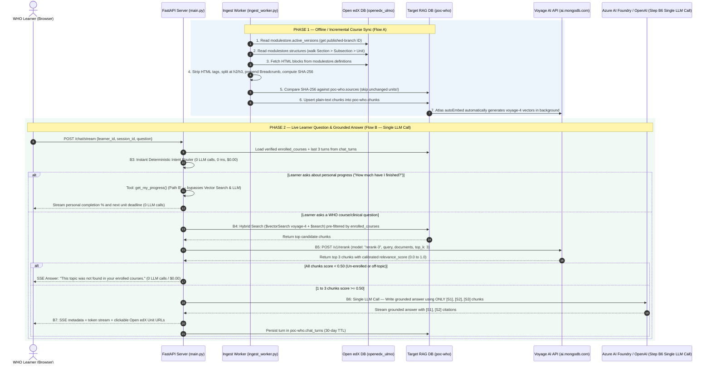

# WHO Academy Open edX Learner Assistant — Technical Architecture & FAQ

This document provides a technical deep-dive into the **World Health Organization (WHO Academy) Open edX Learner Assistant PoC**:
1. **Executive Summary & Architectural Highlights**
2. **UML End-to-End Sequence & Data Flow Diagrams** (From `openedx_ulmo` to Streamed Answer)
3. **Database Deep Dive: Open edX Modulestore (`openedx_ulmo`) vs. RAG Database (`poc-who`)**
4. **Codebase Walkthrough** (File-by-File Explanation)
5. **Interactive Walkthrough Guide**
6. **Frequently Asked Questions (FAQ)**

---

## 1. Executive Summary: What Problem Does This Solve?

WHO Academy runs **Open edX (`openedx_ulmo`)**, where course content is stored as deeply nested trees of raw HTML blocks across `128` courses (`153,885` historical edit snapshots and `91,867` block definitions).

When WHO health workers and learners ask clinical or policy questions inside a course, a standard chatbot fails in three ways:
1. **Hallucination Risk:** Clinical and public-health training requires **100% grounded answers** with verifiable links to the exact WHO course unit—never unverified LLM guesses.
2. **Multi-Tenant Course Security:** A learner enrolled in *Hand Hygiene* or *Clinical Trials* must **never** retrieve content from restricted or un-enrolled courses.
3. **Operational Complexity of Vector Pipelines:** Maintaining separate vector databases, external embedding queues, and re-embedding unchanged HTML every night is expensive and brittle.

### Architecture Overview: MongoDB Atlas + Voyage AI (`autoEmbed` + `rerank-3`)
* **Zero Embedding Pipeline Code (`autoEmbed`):** The Python ingestion worker writes **plain text only** to MongoDB Atlas (`poc-who.chunks`). MongoDB Atlas automatically generates and maintains **`voyage-4`** embeddings inside the database.
* **SHA-256 Delta Sync:** Only modified Open edX HTML units are updated—unchanged units trigger **0 writes and $0 embedding cost**.
* **Hybrid Search (`$vectorSearch` + `$search`):** Combines semantic meaning (`voyage-4`) with exact medical acronym matching (`ODK`, `GSED`, `ABCDE`, `SAMPLE`, `MAF-TB`, `ICH E6`).
* **Voyage AI `rerank-3` + Strict `≥ 0.50` Off-Topic Cutoff:** Every retrieved chunk is scored by `rerank-3` (`https://ai.mongodb.com/v1/rerank`). If no chunk scores `≥ 0.50`, the assistant refuses to guess and returns *"This topic was not found in your enrolled courses"* with **0 LLM calls**.

---

## 2. UML Diagrams: From Open edX Modulestore (`openedx_ulmo`) to Learner Answer

### A. UML Component & Data Flow Diagram (Ingestion + Retrieval)

```mermaid
flowchart TB
  subgraph SourceDB["1. Open edX Split Modulestore Database (openedx_ulmo)"]
    AV["modulestore.active_versions<br/>(128 courses — points to published-branch)"]
    ST["modulestore.structures<br/>(153,885 version trees — reads ONLY the 1 active published tree per course)"]
    DF["modulestore.definitions<br/>(91,867 blocks — 4,955 raw HTML lecture blocks)"]
    FS["fs.files & fs.chunks<br/>(38,275 GridFS binary docs — bypassed by RAG)"]
    AV -->|published-branch ObjectId| ST
    ST -->|definition ObjectId| DF
  end

  subgraph Ingestion["2. Delta Ingestion Worker (ingest_worker.py)"]
    EX["Extract Published Course Tree<br/>(Section > Subsection > Unit)"]
    CL["Clean HTML & Split at h2/h3<br/>(~400 words + 60-word overlap)"]
    BC["Prepend Breadcrumb Header<br/>'Course: ... | Section: ... | Unit: ...'"]
    SH["Compute SHA-256 Hash<br/>(Skip if unchanged in poc-who.sources)"]
    DF --> EX --> CL --> BC --> SH
  end

  subgraph TargetDB["3. MongoDB Atlas RAG Database (poc-who)"]
    CH[("chunks (348 plain-text docs)<br/>No float[] vectors in Python!")]
    SR[("sources (275 unit hashes)")]
    CS[("courses (9 courses)")]
    CT[("chat_turns (30-day TTL)")]
    BR[("benchmark_runs")]
    IDX_V["Atlas Vector Index: chunks_vector<br/>(autoEmbed: voyage-4)"]
    IDX_T["Atlas Search Index: chunks_text<br/>(lucene.standard)"]
    SH -->|Upsert changed plain text| CH
    SH -->|Update hash| SR
    CH --- IDX_V
    CH --- IDX_T
  end

  subgraph Runtime["4. Live Answer Pipeline (rag_service.py)"]
    Q["Learner Question + learner_id"]
    RT["Step 1: Resolve Enrolled Courses<br/>& Instant Intent Router (0 LLM Calls / $0)"]
    HY["Step 2: Pre-Filtered Hybrid Search<br/>($rankFusion over voyage-4 Vector + Text)"]
    RR["Step 3: Voyage AI rerank-3<br/>(POST ai.mongodb.com/v1/rerank)"]
    GT{"Best Score >= 0.50?"}
    NF["Return Safe Refusal (0 LLM Calls):<br/>'Topic not found in enrolled courses'"]
    GEN["Single LLM Call (SSE)<br/>with [S1], [S2] Unit Citations"]

    Q --> RT
    RT -->|search_course_content| HY
    IDX_V --> HY
    IDX_T --> HY
    HY -->|Top Candidates| RR
    RR --> GT
    GT -->|No (< 0.50)| NF
    GT -->|Yes (Top 1-3 Chunks)| GEN
    GEN -->|Save Turn| CT
  end
```

---

### B. UML Sequence Diagram: End-to-End Runtime Flow



---

## 3. Database Architecture: `openedx_ulmo` vs. `poc-who`

### A. Why We Don't Search `openedx_ulmo` Directly
In the Open edX Split Modulestore (`openedx_ulmo`) database:
* **`modulestore.active_versions` (`128` docs):** Points to the active `published-branch` of each course.
* **`modulestore.structures` (`153,885` docs):** Contains every historical Studio edit snapshot ever saved (~1,200 historical versions per course).
* **`modulestore.definitions` (`91,867` docs):** Contains raw HTML with `<script>`, `<style>`, `<iframe>`, and quiz XML, without storing which course or section the block belongs to.
* **`fs.files` & `fs.chunks` (`38,275` docs):** Binary GridFS chunks used by Open edX's `MongoContentStore` for course images and PDFs.

**Key Architectural Design Choice:**
> Vector Search is never attached directly to `modulestore.definitions` because 98% of `modulestore.structures` are historical draft snapshots, and `definitions` contain raw HTML without course/section context. Instead, `ingest_worker.py` follows `modulestore.active_versions.versions.published-branch` to extract **only the 1 live published version** of each course into `poc-who.chunks` (`348` clean plain-text documents). That keeps the vector index compact, fast, and 100% free of draft noise.

---

### B. Target RAG Database (`poc-who`)

| Collection | Count | Purpose |
| :--- | :---: | :--- |
| **`courses`** | `9` | Course catalog metadata (`_id: "course-v1:WHOA+0006_BEC_EN+2026"`, `title`, `org`, `version`). |
| **`sources`** | `275` | One document per Open edX lecture unit with its `sha256` hash for incremental delta sync. |
| **`chunks`** | `348` | Clean plain-text chunks with `Course | Section | Unit` breadcrumb headers. Indexed by **`chunks_vector`** (`autoEmbed` `voyage-4`) and **`chunks_text`** (`lucene.standard`). |
| **`ingest_runs`** | `21+` | Telemetry log of each ingestion run (`sources_seen`, `sources_changed`, `chunks_upserted`). |
| **`chat_turns`** | Dynamic | Learner Q&A history with citations, automatically cleaned up after 30 days via TTL index `idx_chat_turns_ttl`. |
| **`benchmark_runs`** | Dynamic | Saved Voyage AI model benchmark runs from Tab 4. |

---

## 4. Codebase Walkthrough: What Every Python File Does

The project is organized into **6 modular Python files**:

### 1. [`db.py`](../db.py) — *Database Connection & Index Provisioning*
* Connects to both `MONGODB_DB_NAME` (`poc-who`) and `OPENEDX_MODULESTORE_DB_NAME` (`openedx_ulmo`) using async Motor (`AsyncIOMotorClient`).
* [`ensure_indexes()`](../db.py) idempotently creates:
  1. Standard B-tree indexes + the 30-day TTL index (`idx_chat_turns_ttl`) on `chat_turns.created_at`.
  2. **`chunks_vector`** — MongoDB Atlas Vector Search index with `type: "autoEmbed"`, `model: "voyage-4"`, `path: "text"`, and pre-filters on `course_id` and `is_active`.
  3. **`chunks_text`** — MongoDB Atlas Search index (`lucene.standard`) on `text` with filter fields `course_id` and `is_active`.

### 2. [`ingest_worker.py`](../ingest_worker.py) — *Open edX Split Modulestore Extractor & Delta Chunker*
* [`extract_courses_from_openedx_modulestore()`](../ingest_worker.py): Queries `openedx_ulmo.modulestore.active_versions`, loads the `published-branch` structure from `modulestore.structures`, walks the DAG (`course` $\rightarrow$ `chapter` $\rightarrow$ `sequential` $\rightarrow$ `vertical` $\rightarrow$ `html`), and pulls raw HTML from `modulestore.definitions`.
* [`clean_html_preserving_headings()`](../ingest_worker.py) & [`build_chunks_for_block()`](../ingest_worker.py): Strips `<script>`/`<style>` tags with BeautifulSoup, splits at `<h2>`/`<h3>` boundaries (~400-word windows with 60-word overlap), and prepends the breadcrumb header (`Course: ... | Section: ... | Unit: ...`).
* [`ingest_course()`](../ingest_worker.py): Compares the unit's SHA-256 against `poc-who.sources`. If unchanged, skips it (`0` writes). If changed, upserts plain-text chunks into `poc-who.chunks` and logs metrics in `poc-who.ingest_runs`.

### 3. [`rag_service.py`](../rag_service.py) — *Instant Intent Router, Hybrid Search, Voyage Reranker & SSE Streamer*
* [`route_and_rewrite_query()`](../rag_service.py): Instant deterministic intent router (`0 LLM calls`, `0 ms`, `$0.00`) that chooses between `get_my_progress` (personal progress) or `search_course_content` without paying for a pre-search "LLM Query Beautifier" call (`voyage-4` embeds natural-language questions directly at 100% accuracy).
* [`hybrid_search_chunks()`](../rag_service.py): Runs `$rankFusion` (on MongoDB 8.0+) or Reciprocal Rank Fusion (`merge_rrf_candidates`) over `$vectorSearch` + `$search`, strictly pre-filtered by `course_id: {"$in": enrolled_courses}` and `is_active: True`.
* [`rerank_chunks()`](../rag_service.py): Calls `POST https://ai.mongodb.com/v1/rerank` (`rerank-3` or `rerank-3-lite`) with polite rate-limit pacing, retry/backoff on HTTP 429, and request deduplication. Drops all chunks scoring `< 0.50`.
* [`stream_chat_answer()`](../rag_service.py): Orchestrates the pipeline, invokes the LLM **once** (`Step B6`) on surviving chunks (`>= 0.50`) — or **0 times** if blocked by the safety gate — streams tokens over Server-Sent Events (`SSE`), attaches `[S1]`/`[S2]` unit URLs, and saves the turn to `chat_turns`.

### 4. [`benchmark_service.py`](../benchmark_service.py) — *Search Mode & Reranker Benchmark Engine*
* Evaluates 5 runtime profiles (`hybrid`, `vector`, `lexical` × `rerank-3`, `rerank-3-lite`, `none` on the `voyage-4` `autoEmbed` index) against the **10-Question WHO Golden Benchmark Suite**.
* Deduplicates identical retrieval and rerank calls so `ai.mongodb.com` is never called redundantly, measures pure HTTP execution latency, computes `Chunks Sent to LLM (>=0.50)` and `Search Cost (per 1,000 Questions)`, saves results to `benchmark_runs`, and exports [`docs/benchmark_report.md`](./benchmark_report.md).

### 5. [`main.py`](../main.py) — *FastAPI Server & REST / SSE Endpoints*
* Exposes `/dashboard`, `/status`, `/status/check`, `/chat/stream`, `/chat/rate`, `/ingest/run`, `/ingest/preview`, `/pipeline/inspect`, and `/benchmark/run`.

### 6. [`dashboard_ui.py`](../dashboard_ui.py) — *WHO-Branded 5-Tab Interactive Web Studio*
* Provides the visual UI in WHO white & blue (`#008DC9`) styling across 5 tabs.

---

## 5. Interactive Walkthrough Guide

1. **Tab 1 — `1. Course Topics & Sample Questions`:**
   * Browse the plain-English overview of all indexed WHO courses (`H0118EN`, `0006_BEC_EN`, `H0117EN`, `HQ_SPTB_EN`, `H0140EN`, `IHH`, `MAT`, plus the restricted `BIO+2026` security test) and click any sample question button to test it live in Tab 2.
2. **Tab 2 — `2. Live Course Assistant (Q&A Demo)`:**
   * Click preset pill **`Emergency Care (0006_BEC_EN): ABCDE & SAMPLE History`** $\rightarrow$ click **`Trace & Stream Answer`**. Inspect the 3 pipeline step cards (`1. Learner Course Access Filter` $\rightarrow$ `2. MongoDB Atlas Hybrid Search` $\rightarrow$ `3. Voyage AI Reranker (>= 0.50) + 1 LLM Call`), the `rerank-3` scores (`> 0.90`), and the full-width formatted LLM answer hero card with clickable `[S1]` links.
   * Click preset pill **`Security Test: Un-Enrolled Course (BSL-4 Blocked)`** $\rightarrow$ click **`Trace & Stream Answer`**. Verify that `0/3` chunks survive the `≥ 0.50` cutoff (`0 LLM calls / $0.00`) and the assistant refuses to guess.
   * Click preset pill **`Personal Progress: My Course Completion`** $\rightarrow$ see how the intent router calls `get_my_progress` and bypasses vector search and LLM calls.
3. **Tab 3 — `3. Open edX Course Ingestion`:**
   * Click **`Preview Chunking Only`** to inspect how raw Open edX HTML is stripped of tags and prefixed with `Course | Section | Unit` breadcrumbs.
   * Notice that the JSON document written to MongoDB has **no `embedding: [...]` array in Python**—Atlas `autoEmbed` handles vectors automatically.
4. **Tab 4 — `4. Search & Reranker Benchmark`:**
   * Expand **`Inspect 10 WHO Golden Benchmark Questions`** to see the real questions across `H0118EN`, `H0117EN`, `0006_BEC_EN`, `HQ_SPTB_EN`, and `H0140EN`.
   * Inspect the **Executive Model Comparison Matrix**: **`Recommended Baseline (Hybrid + rerank-3)`** achieves **`100%` Top-1 Accuracy** and **`100%` Recall@3** (at **`$0.080` per 1,000 questions** for search + rerank, filtering 8 retrieved candidates down to **`1.5 kept (max 3)`**), compared to `90.0%` for `rerank-3-lite`, `80.0%` for `Vector-Only`, `70.0%` for `Lexical-Only`, and `40.0%` (`FAIL` on Off-Topic Cutoff) for `No Reranker`.
5. **Tab 5 — `5. System Health Check`:**
   * Verify live connectivity and latency across MongoDB Atlas (`poc-who` + `openedx_ulmo`), Voyage AI (`ai.mongodb.com/v1/rerank`), and the Azure AI Foundry / OpenAI Gateway.

---

## 6. Frequently Asked Questions (FAQ)

### Q1: Why are only `html` blocks indexed from `modulestore.definitions`? What about `problem` (quizzes) and `video` blocks?
* **Excluding `problem` blocks (`7,875` docs):** In Open edX, `problem` blocks contain graded certification exam questions and answers. Excluding `block_type: "problem"` prevents learners from using the AI assistant to look up answers to graded WHO certification assessments.
* **Adding `video` transcripts and PDFs:** Video transcripts (`.srt`/`.vtt`) and PDF handouts convert into plain-text chunks in the **same `poc-who.chunks` collection** (with deep links to the video timestamp), and Atlas `autoEmbed` embeds them automatically without changing search or reranking code.

### Q2: WHO operates in 6 official UN languages (EN, FR, ES, AR, ZH, RU). Does this architecture support multilingual courses?
* Yes. `openedx_ulmo` contains courses in English, French, Spanish, Arabic, Chinese, Portuguese, and Russian.
* Both **Voyage AI `voyage-4`** and **`rerank-3`** are natively multilingual across 100+ languages (including all 6 UN languages) and support **cross-lingual retrieval** (a learner can ask a question in French and retrieve a citation from an English WHO reference guideline, or pre-filter by `language` in `poc-who.chunks`).

### Q3: How does this integrate into Open edX (`openedx_ulmo`) in production without modifying Open edX core code?
* **Zero Core Modifications:**
  1. **Studio Publish Webhook:** When a course author clicks *"Publish"* in Open edX Studio, Open edX fires its standard `COURSE_PUBLISHED` signal/webhook $\rightarrow$ calls `POST /ingest/run` for that `course_id`. Because of SHA-256 delta hashing, only the edited unit is updated in `< 2 seconds`.
  2. **LMS Frontend Widget:** The chat UI plugs into Open edX LMS as a standard **Micro-Frontend (MFE) slot or XBlock**, passing the learner's authenticated session token to `POST /chat/stream`.

### Q4: What is the estimated cost for Voyage AI embeddings, reranking, and LLM calls across all 128 WHO courses?
1. **Initial Catalog Embedding (All 128 Courses / `4,955` HTML blocks $\approx 2.5\text{M}$ tokens):**
   * Using `voyage-4` (`$0.06 / 1M tokens`): **~$0.15 total (15 cents)** to embed the entire WHO Academy course catalog.
   * **Ongoing Course Updates:** Near **$0.00/day** because the SHA-256 check (`poc-who.sources`) skips unchanged units.
2. **Pre-Search Intent Router (`Step B3`):** **`$0.000 / 1,000 questions` (0 LLM Calls).** Deterministic intent routing avoids any pre-search LLM call because `voyage-4` embeds natural-language learner questions directly.
3. **Live Search + Voyage Reranking (`Steps B4 & B5`):** **`$0.080 / 1,000 questions`** (`$0.001` for `voyage-4` query auto-embedding at `$0.06 / 1M` + `$0.079` for `rerank-3` scoring 8 candidates at `$0.05 / 1M`, or `$0.033 / 1,000 questions` with `rerank-3-lite` at `$0.02 / 1M`).
4. **Single Grounded LLM Answer Call (`Step B6`):** **`~$0.180 / 1,000 questions`** (and **`$0.000`** when blocked by the `< 0.50` off-topic cutoff). Because `rerank-3` filters 8 candidate chunks down to an average of **`1.5 kept chunks`**, it cuts final LLM input tokens by **~60%**, bringing total end-to-end cost (Search + Rerank + 1 LLM Call) to **~$0.26 per 1,000 learner questions ($0.00026 per question)**.

### Q5: How does this architecture handle Learner Data Privacy & UN/WHO Data Governance?
* **Course Isolation:** Enforced inside the MongoDB query stage (`course_id: {"$in": enrolled_courses}`) before any chunk reaches the reranker or LLM.
* **Zero Model Training:** Neither MongoDB Atlas Automated Embedding (`ai.mongodb.com`) nor Voyage AI trains models on WHO content or learner queries.
* **Automatic Data Retention (GDPR / UN Compliance):** `poc-who.chat_turns` uses a native MongoDB **TTL Index (`idx_chat_turns_ttl`)** that automatically purges learner chat history after the configured retention window (30–90 days).
